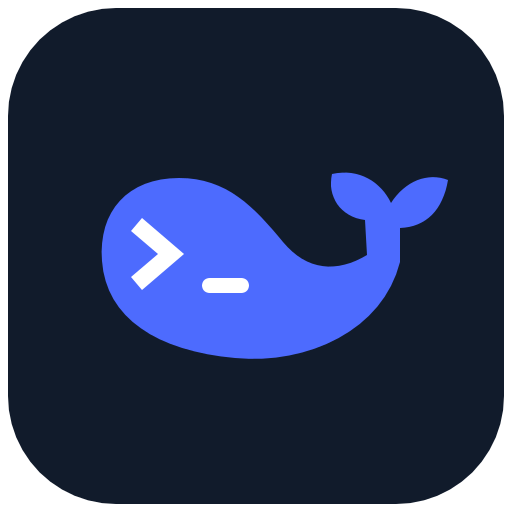

<!-- EDITION:proxy -->
# Codex 模型扩展

**你的模型，原版 Codex。**

把已有云端接口和本地模型加入 Codex 的模型菜单。保留原登录、聊天记录与原生工具，在同一个聊天里切换模型，用一个设置窗口管理连接和自动更新。

扩展版 **0.5.11-proxy.1** · 更新分支 `codex/existing-proxy-models`
<!-- /EDITION -->
<!-- EDITION:ds -->
# Codex × DeepSeek

**在原版 Codex 里用 DeepSeek。**

把 DeepSeek Flash 加入 Codex 的模型菜单。保留 GPT、原登录与原生工具，同一个聊天里自由切换；密钥、上下文和自动更新都可在设置窗口管理。

DS 版 **0.5.11-proxy.1** · 更新分支 `main`
<!-- /EDITION -->

[English](README.en.md) · [验证记录](docs/VALIDATION.md) · [实现说明](docs/ARCHITECTURE.md) · [MIT](LICENSE)

## 两个版本

| 版本 | 接入范围 | 更新通道 |
| --- | --- | --- |
| [DS 版](https://github.com/limyum-creator/codex-deepseek-patch/tree/main) | 原生 GPT + DeepSeek Flash | `main` |
| [扩展版](https://github.com/limyum-creator/codex-deepseek-patch/tree/codex/existing-proxy-models) | 原生 GPT + 已有云端接口 / 本地服务；DeepSeek 可选 | `codex/existing-proxy-models` |

两个版本分别发布、分别更新。扩展版不要求配置 DeepSeek，也不管理外部服务的订阅登录。

## 这一版怎么工作

- **官方应用保持原样**：不改 ASAR、不复制 Windows 应用、不重新签名 Mac 应用。Windows 使用原 Store 包身份，应用自身的更新由官方处理。
- **同聊天切换**：模型菜单使用原生目录。聊天 ID、工作目录、权限和历史保留；等当前回复结束再切换。
- **原登录和工具**：GPT 沿用官方认证；其他模型只使用各自服务的凭据。原生工具继续由 Codex 发现、授权和执行。
- **上下文按模型最大值**：规格与选择共用一份目录；用户主动调小的窗口、隐藏型号继续保留。本地服务加载窗口可单独保留。
- **原生功能与压缩**：保留原生身份和下一步指令预判的调用链路。GPT 的等待时限、压缩和重试由 Codex 控制；外部模型用自己的接口生成可读摘要。跨模型隔离专有思考签名，保留可读对话、工具结果和各自的上下文窗口。
- **自动维护**：官方应用更新后验证兼容性；适配层代码、模型列表和规格分别检查。无变化时安静运行，失败保留当前可用版本。模型列表或规格单独变化时静默准备，准备完成后临时监听 Codex 退出事件，退出后触发安装；快速重开会安全延后；新补丁版本仍显示更新进度。

适配器按 **Responses / Chat Completions 协议和显式能力**工作，不按厂商名称决定路由。Claude、GLM、Qwen 等可通过提供这两类兼容接口的现有服务接入；原生 Anthropic Messages API 尚未实现。服务没有提供的规格可以手动声明，不给未知型号套用任意小窗口。

## 轻量化设计

运行时是一个仅监听本机回环地址的 Python 标准库进程，负责请求转发与必要的格式转换。没有额外聊天界面、数据库、模型运行引擎或订阅登录系统。模型推理由原有服务完成，工具由 Codex 执行。

适配器由系统按用户启动；更新监测由 launchd / Windows 任务计划程序定时执行，检查后退出。Windows 使用无控制台 Python。发布包仅含源码和文档；旧应用修改逻辑保留用于历史版本的恢复和回归，新安装路径不执行它。

需要 **Python 3.11+** 和已安装的官方 macOS / Windows Codex。新架构安装与自动验证无需额外 Node.js；原生工具使用 Codex 自带运行时。外部模型服务需自行准备。

指令预判由官方客户端在回复结束、输入框为空等条件下触发，还受功能开关、模型支持、服务端抽样和请求时限影响。补丁保留原生预判链路；预判请求成功与输入框实际展示分别验证。

<!-- EDITION:proxy -->
## 接入已有服务

```sh
git clone --branch codex/existing-proxy-models https://github.com/limyum-creator/codex-deepseek-patch.git
cd codex-deepseek-patch
```

### Ollama / LM Studio / 通用兼容接口

```sh
python3 patch.py connect --name local --kind ollama --url http://127.0.0.1:11434/v1
# LM Studio：--kind lmstudio，通常端口为 1234。
# Chat Completions 服务：
python3 patch.py connect --name compatible --kind openai --url https://example.com/v1 \
  --wire-api chat_completions --key-file /absolute/path/key.txt \
  --models MODEL_ID --context-window 202752
```

`connect` 查询模型元数据并保存连接，输出 `saved` 文件路径；构建时传给 `--connections`。`--models` 可限定型号。`--context-window` 用于服务未声明最大窗口的情况，请填写所用模型的实际规格。

- `--respect-server-context`：把本地服务当前较小的加载窗口作为用户选择保留；不会修改服务加载参数。
- `--key-file`：读取已有密钥文件，连接配置只保存路径。
- `--supports-reasoning-effort`：仅当 Chat Completions 服务明确支持 `reasoning_effort` 时开启。可选思考档位由模型元数据或连接中的 `model_specs` 声明。
- 未知协议、无法转换的输入类型会返回具体错误，不会悄悄删除消息或工具。

连接文件中的 `model_specs` 可补充 `context_window`、`reasoning_levels`、`input_modalities`、`supports_tools`。模型最大值与用户调小值分开保存。只聊天的模型不会得到无法执行的工具声明。

### 已经配置好的 EasyCLI / CLIProxyAPI

构建时使用 `--proxy-config /absolute/path/config.yaml`，默认地址为 `http://127.0.0.1:8317/v1`。可用 `--proxy-base-url` 指定其他地址。

读取现成配置中的客户端 API key，OAuth 凭证继续由外部服务管理。默认显示已配置的 Grok 4.5 / 4.7、Gemini 3.8 Flash、Opus 4.6 Thinking；可用 `--proxy-models` 限定。自动同步只增加已启用 Grok、Gemini Flash、Opus 系列的新版本，保留手动隐藏。

需要 DeepSeek 时先运行 `python3 patch.py setup-key`，构建加入 `--with-deepseek`；不使用时无需设置。

<!-- /EDITION -->
<!-- EDITION:ds -->
## 首次准备

```sh
git clone --branch main https://github.com/limyum-creator/codex-deepseek-patch.git
cd codex-deepseek-patch
python3 patch.py setup-key
```

DeepSeek 使用独立 API Key；GPT 继续使用已有官方登录。
<!-- /EDITION -->

## 构建、验证、安装

macOS 示例，使用新的空输出目录：

<!-- EDITION:ds -->
```sh
python3 patch.py build --app /Applications/ChatGPT.app \
  --with-deepseek --output /absolute/path/build --verify
```
<!-- /EDITION -->
<!-- EDITION:proxy -->
```sh
python3 patch.py build --app /Applications/ChatGPT.app \
  --connections /absolute/path/connections.json --output /absolute/path/build --verify
```
<!-- /EDITION -->
```sh
# 正常退出 Codex 后：
python3 patch.py install /absolute/path/build
python3 monitor.py enable --app /Applications/ChatGPT.app --baseline /absolute/path/build
```

`--connections` 和 `--proxy-config` 可组合；至少选择一个外部来源，也可单独 `--with-deepseek`。Windows 使用 `python` 和 Windows 路径；`--app` 可省略，自动发现官方安装。

`--verify` 使用隔离的原生 CLI 和本机模拟接口，在后台验证路由、工具、思考档位、窗口、同聊天切换及压缩。不会打开测试桌面窗口，不调用付费模型。验证通过后才允许安装。

从旧补丁迁移时指定 `--baseline /path/to/old-build`。Mac 的 `--app` 指向旧构建保留的、通过官方签名验证的 `original.app`，`--install-target` 指向原安装位置。首次迁移恢复官方应用，后续更新只替换适配代码和受管配置。Windows 沿用已注册的官方 Store 应用。

已有聊天继续通过原生接口保留 ID、内容、归档、模型和思考档位。旧 GPT 专有压缩块改为按当前聊天身份与压缩块核对本机可读记录，由当前选择的模型生成并缓存摘要，使用该模型自己的凭据，**无需 GPT 额度**。分叉对话只继承分叉点之前的记录，原文件保持不变。

已有摘要缓存继续复用；长历史按当前模型的有效窗口分块，小窗口也不会直接塞入过大的旧摘要。若可读记录缺失、损坏或格式无法验证，会提示恢复原记录或补充任务摘要，不会悄悄丢弃历史。摘要生成会使用所选服务的额度。

## 可视化设置

安装并开启监测后，从 **Mac 的“应用程序”用户目录**或 **Windows 开始菜单**打开“Codex 模型设置”。也可运行：

```sh
python3 patch.py settings
```

窗口分为“概览、模型与连接、更新与维护”三页：

- 检查更新、重新打开进度、诊断并复制脱敏报告。
- 检测现成接口、勾选型号、管理凭据引用；扩展版可单独启停 DeepSeek。
- 查看模型最大窗口、服务加载窗口和实际使用值；修改显示、窗口与压缩阈值，或恢复默认。
- 调整代码更新、模型同步、检查周期、图片工具；清理过期缓存和处理安装恢复。
- 查看旧历史恢复的分块进度、摘要缓存使用情况，需要时取消恢复。

窗口按需启动，关闭后退出，不增加常驻管理服务。保存采用冲突检查，保留已有连接、手动隐藏和主动调小的窗口。首次安装仍使用上面的命令；设置窗口用于已安装版本的日常管理。

## 非阻塞更新进度

发现补丁新版本后显示“**Codex 模型补丁更新**”窗口，并标明 DS 版或扩展版。可继续工作或关闭窗口。点击“开始更新”后，准备和兼容性校验通过才正常关闭 Codex；安装时提示暂勿启动。完成后显示“启动 Codex”按钮，由用户决定何时打开。官方 Codex 客户端仍由官方更新机制维护。

有实际文件数量的阶段显示计数，无法预估时使用活动进度条。相同版本不会每次检查都重复弹窗；关闭过程窗口后，完成时会再提示一次。旧版本首次升级在下载到新版组件后开始显示进度；后续从发现版本开始显示。

## 更新与偏好

```sh
python3 monitor.py status
python3 monitor.py run-once --sync-now
python3 monitor.py model-options --model MODEL_ID --context-window 32768
python3 monitor.py model-options --model MODEL_ID --hide
python3 monitor.py model-options --model MODEL_ID --reset-context
```

监测默认启用代码更新与模型同步，可在启用时分别用 `--no-code-updates` / `--no-model-sync` 关闭。正在使用 Codex 时等待退出后安装。更新包优先一次下载完整源码，再逐文件校验；旧客户端下载方式仍兼容。检查版本通道、不可变提交、文件摘要及隔离测试，DS 与扩展不会交叉覆盖。用户主动检查会排队，不被正在运行的检查丢弃。过期清理只处理本版本拥有、未被安装或恢复链引用的缓存，保留最近回退版本。

```sh
python3 patch.py status /absolute/path/build
python3 monitor.py disable
python3 patch.py recover /absolute/path/build  # 恢复中断的安装
python3 patch.py restore /absolute/path/build  # 撤销本适配层，恢复先前配置
```

恢复命令保留官方应用；旧补丁迁移前已有的外部提供方配置仍按原记录恢复。Mac 不重置钥匙串或系统隐私权限；首次从旧本地签名切回官方身份时，系统可能要求确认相应权限。日常更新不再重新签名。

## 可选图片工具

```sh
python3 patch.py setup-images --proxy-config /absolute/path/config.yaml
```

复用已有 CPA 的图片接口，将其注册为可选 MCP 工具。图片模型、账号权限和额度由外部服务提供。聊天模型具备工具能力即可请求调用；不会把“能聊天”自动当成“具备生图权限”。

非官方项目。请勿提交官方程序、生成的模型目录、个人日志、账号配置或凭据。问题反馈请附系统、Codex 版本、适配层版本、接口类型和脱敏错误。真实模型实测与模拟协议覆盖分别记录在[验证文档](docs/VALIDATION.md)。

## 原生云端功能排查

Dot 使用官方客户端自己的云端长连接。若反复重连，先检查系统 DNS 与代理／VPN 的分流；系统代理能访问网页，不代表原生长连接一定走相同路径。适配层不会自动改全局 DNS、关闭 VPN 或修改官方应用。可用设置窗口导出脱敏诊断；反馈时附连接错误和系统版本。

## 仓库导航

- 安装和日常管理：根目录 `patch.py`、`monitor.py`，原命令保持可用。
- 实现代码：[`src/`](src/)；内部测试和维护脚本位于 `src/tests/`、`src/scripts/`。
- 技术说明：[`docs/`](docs/)；参与开发见 [CONTRIBUTING.md](CONTRIBUTING.md)。

自动更新包保留旧版所需的文件路径，由整理后的源码生成。目录调整不增加常驻服务，也不影响两个版本的独立更新。
